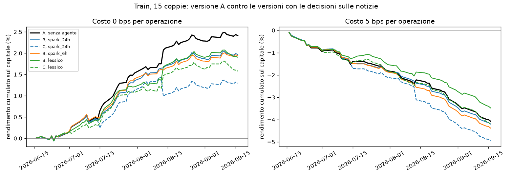
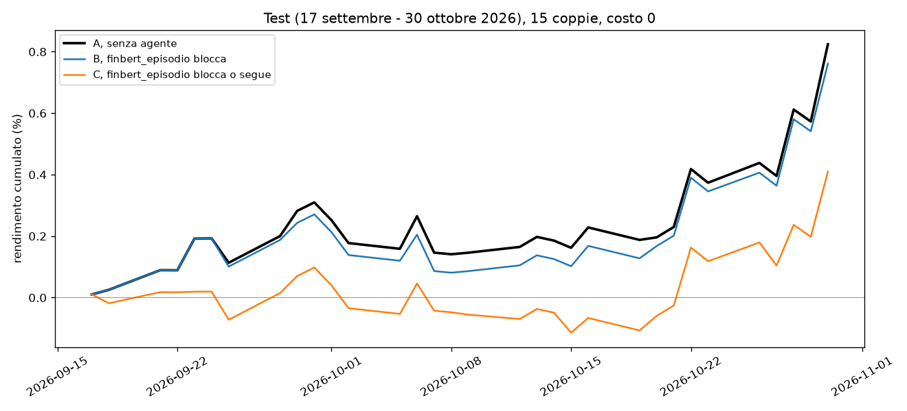
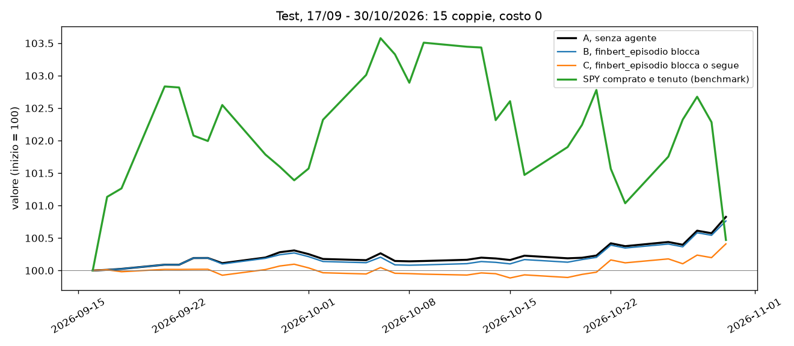

# Resoconto: la strategia e l'agente di notizie alla prova del backtest

Questo resoconto spiega che cosa abbiamo provato e che cosa è uscito, senza dare per scontata nessuna conoscenza di finanza. I numeri delle sezioni 1-9 vengono da [src/06_backtest.ipynb](../src/06_backtest.ipynb) e riguardano il **periodo di addestramento** (train, dal 16 giugno al 16 settembre 2026, 64 giorni di borsa). La sezione 10 riguarda il **periodo di test** (dal 17 settembre al 30 ottobre 2026, 32 giorni di borsa), usato una volta sola: i numeri vengono da [src/06_test_backtest.ipynb](../src/06_test_backtest.ipynb) e [src/07_test_robustezza.ipynb](../src/07_test_robustezza.ipynb). Le tabelle sono in questa cartella e in [test/](test/). La sintesi di domanda di ricerca, risultati e richieste del professore è in [docs/Sintesi.md](../docs/Sintesi.md).

## In breve

- La strategia di base (versione A) fa 973 operazioni e guadagna in media 7,4 punti base per operazione, cioè lo 0,074%. Su un capitale di 300.000 dollari sono 7.239 dollari in tre mesi (+2,4%).
- Il guadagno è così piccolo che i costi di compravendita lo cancellano: basta un costo di 1,9 punti base per operazione per azzerarlo. Con un costo realistico di 5 punti base la strategia perde 12.221 dollari (-4,1%).
- L'agente di notizie doveva evitare le operazioni sbagliate. Invece blocca operazioni che in media guadagnavano **più** delle altre: 27,8 punti base contro 7,4. Ha fatto peggio di un blocco a caso.
- Seguire la notizia (versione C) peggiora ancora: le 13 operazioni in cui l'agente segue la notizia perdono in media 155 punti base.
- Una versione più semplice senza intelligenza artificiale, che conta le parole positive e negative delle notizie, blocca in modo indistinguibile dal caso.
- Questi risultati dipendono da pochissime operazioni, soprattutto da un giorno (13 agosto). Sono un'indicazione, non una prova.
- Tra 21 varianti dell'agente il gruppo ha scelto `finbert_episodio` e l'ha provata **sul test**, su dati mai guardati prima. Anche lì le notizie non aiutano: bloccare fa guadagnare 189 dollari meno della A, seguire la notizia 1.242 dollari meno. La strategia di base guadagna ancora senza costi (+2.472 dollari), ma meno che nel train.

## 1. L'idea, in parole semplici

Due aziende che fanno lo stesso mestiere, per esempio Coca-Cola e Pepsi, hanno prezzi di borsa che si muovono insieme: se il mercato delle bibite va bene, salgono entrambe. Ogni tanto, durante la giornata, una delle due si muove più dell'altra senza un motivo vero, magari solo perché qualcuno ha comprato o venduto molto in quel momento. Di solito la distanza rientra dopo poco.

La strategia scommette proprio su questo rientro. Quando la distanza tra le due è insolitamente grande:

- **compra** l'azione rimasta indietro (guadagna se sale);
- **vende allo scoperto** l'azione andata avanti (guadagna se scende). Vendere allo scoperto vuol dire prendere in prestito un'azione, venderla subito e ricomprarla dopo: se nel frattempo il prezzo è sceso, si guadagna la differenza.

Le due operazioni hanno lo stesso importo, 10.000 dollari ciascuna. Se tutto il mercato sale o scende, quello che si guadagna da una parte si perde dall'altra: conta solo come si muovono le due azioni **una rispetto all'altra**. Si guadagna se la distanza rientra, si perde se si allarga ancora. Tutto si chiude entro la fine della giornata.

**Il problema.** A volte la distanza si allarga per un motivo vero: una delle due aziende viene comprata da un'altra, riceve un'indagine, cambia l'amministratore delegato. In quel caso la distanza può non rientrare mai, e la scommessa perde. L'**agente di notizie** è un programma con un modello di intelligenza artificiale che legge le notizie uscite nelle ore prima di ogni segnale e, se trova un fatto del genere su una sola delle due aziende, dice di non entrare.

## 2. Le parole da sapere

| Parola | Cosa vuol dire |
|---|---|
| Coppia | Due aziende dello stesso settore, per esempio Visa e Mastercard. Ne usiamo 15. |
| Spread | La distanza tra i prezzi delle due azioni (precisamente: la differenza dei loro logaritmi). È quello su cui si scommette. |
| z-score | Quanto è insolito lo spread in questo momento, misurato in "deviazioni standard" rispetto alla sua media recente. Si entra quando supera 2 (molto insolito), si esce quando torna a 0 (normale). |
| Segnale | Il momento in cui lo z-score supera la soglia: la strategia vorrebbe entrare. Nel train ce ne sono 973. |
| Trade | Un'operazione completa: apertura delle due posizioni e loro chiusura. |
| Punto base (bps) | Un centesimo di punto percentuale: 1 bps = 0,01%. Su 10.000 dollari, 1 bps = 1 dollaro. |
| Lordo e netto | Lordo: guadagno prima dei costi. Netto: dopo i costi. |
| Costo per operazione | Quanto costa comprare o vendere (commissioni e differenza tra prezzo di acquisto e di vendita). Un trade ha 4 operazioni: aprire e chiudere due azioni. Con 5 bps per operazione il trade costa 20 bps. |
| Costo di pareggio | Il costo per operazione a cui il guadagno medio diventa zero. |
| Uscita | Come finisce un trade: **rientro** (lo spread è tornato normale: di solito si guadagna), **stop** (lo spread si è allargato troppo: si chiude in perdita), **tempo** (dopo 90 minuti si chiude comunque), **fine giornata**. |
| Win rate | La quota di trade chiusi in guadagno. |
| Profit factor | Quanto si è guadagnato nei trade vincenti diviso quanto si è perso in quelli perdenti. Sopra 1: si guadagna in totale. |
| Errore standard | Quanto è incerta una media. Se la media è 7,4 e l'errore standard 2,0, la media vera sta grosso modo tra 3,4 e 11,4. |
| Sharpe ratio | Guadagno diviso per quanto oscillano i guadagni giorno per giorno, riportato a un anno. Più è alto, più il guadagno è regolare. Su 64 giorni e con guadagni giornalieri minuscoli viene gonfiato: un valore come 8 non va confrontato con quello di un fondo. |
| Drawdown | La perdita massima dal punto più alto raggiunto. |
| Train e test | Il periodo di borsa è diviso in due. Sul train (fino al 16 settembre) si costruisce e si prova la strategia; il test (dal 17 settembre) si usa una volta sola alla fine, con le regole bloccate, per vedere se funziona su dati mai visti. **Il test è stato usato una volta sola, il 14 novembre 2026** (sezione 10). |
| p-value | Qui: la probabilità che un blocco fatto a caso dia un risultato altrettanto buono o migliore di quello dell'agente. Piccolo (sotto 0,05) = l'agente sceglie meglio del caso. Vicino a 1 = l'agente sceglie peggio del caso. |

## 3. Come abbiamo messo alla prova la strategia

Un **backtest** rifà sul passato, minuto per minuto, quello che la strategia avrebbe fatto, con le regole decise prima di guardare i risultati:

- 10.000 dollari su ciascuna delle due azioni, senza prestiti per aumentare l'importo;
- capitale totale di 300.000 dollari (20.000 per ognuna delle 15 coppie): ogni coppia ha al massimo un trade aperto alla volta;
- tutto chiuso entro la fine della giornata;
- costi: scenario principale **0** (indicazione del docente per queste 15 coppie), poi 2, 5 e 10 bps per operazione per vedere quanto pesano. 5 è lo scenario realistico.

## 4. Le tre versioni e i cinque set di decisioni

Le **versioni** sono tre modi di usare le notizie:

| Versione | Cosa fa |
|---|---|
| **A**, senza agente | Entra a ogni segnale. È il termine di confronto. |
| **B**, l'agente blocca | Se l'agente trova un fatto vero su una sola azienda, non entra. Altrimenti entra come la A. |
| **C**, l'agente decide | Come la B, ma in alcuni casi, invece di stare fermo, scommette nella direzione della notizia: se la notizia è buona per l'azienda che è salita, scommette che continui a salire rispetto all'altra. È la scommessa opposta a quella della A. Esce quando lo spread rientra (la notizia aveva torto), dopo 90 minuti o a fine giornata. |

I **set di decisioni** sono chi decide, segnale per segnale, se bloccare o seguire:

| Set | Chi decide | Segnali | Blocchi (B) | Segui (C) |
|---|---|---|---|---|
| `spark_24h` (principale) | L'agente con il modello Spark X2.6 4B, che legge le notizie delle 24 ore prima | 973 | 48 | 13 |
| `spark_6h` | Lo stesso agente, con le notizie delle 6 ore prima | 973 | 25 | 9 |
| `lessico` | Nessun modello: conta le parole positive e negative delle notizie con un dizionario della finanza (Loughran-McDonald) | 973 | 166 | 61 |
| `spark_24h_ragiona` | L'agente con il modello che "ragiona" prima di rispondere (molto più lento) | 40 | 5 | 2 |
| `mano` | Il gruppo, che ha classificato a mano le notizie, con la stessa regola dell'agente | 40 | 5 | 1 |

Gli ultimi due esistono solo per un campione di 40 segnali, perché classificare a mano e far ragionare il modello costa molto tempo.

## 5. Risultati della versione A

| Costo per operazione | Trade | Guadagno medio per trade | Trade in guadagno | Guadagno totale | Sul capitale |
|---|---|---|---|---|---|
| 0 bps | 973 | +7,4 bps | 60% | +7.239 $ | +2,4% |
| 2 bps | 973 | -0,6 bps | 53% | -545 $ | -0,2% |
| 5 bps | 973 | -12,6 bps | 39% | -12.221 $ | -4,1% |
| 10 bps | 973 | -32,6 bps | 20% | -31.681 $ | -10,6% |

Come leggerla:

- **Il guadagno c'è ma è piccolo**: 7,4 bps per trade, con un'incertezza di ±2 bps. Su 10.000 dollari sono 7,4 dollari a trade.
- **I costi lo mangiano tutto.** Il costo di pareggio è 1,86 bps per operazione: un trade costa 4 operazioni, quindi 7,4 bps, esattamente quanto guadagna in media. Un costo realistico è più alto.
- **Si guadagna solo quando lo spread rientra.** I 464 trade usciti per rientro guadagnano in media 38,8 bps; i 422 usciti per tempo perdono 23,2 bps e i 31 usciti per stop perdono 32,1 bps.
- **Il guadagno si concentra all'apertura.** I segnali tra il 15° e il 30° minuto di borsa (457) guadagnano 11,4 bps: è il rientro dei movimenti accumulati durante la notte. Quelli successivi (516) solo 3,9 bps.

## 6. Risultati della versione B: l'agente blocca i trade sbagliati?

Il confronto con la A, a costo 0:

| Set | Trade | Guadagno medio per trade | Guadagno totale | Differenza dalla A |
|---|---|---|---|---|
| A, senza agente | 973 | +7,44 bps | +7.239 $ | |
| B, `spark_24h` | 925 | +6,38 bps | +5.905 $ | -1.334 $ |
| B, `spark_6h` | 948 | +6,14 bps | +5.819 $ | -1.420 $ |
| B, `lessico` | 807 | +7,08 bps | +5.712 $ | -1.527 $ |

**Tutti i set guadagnano meno della A.** Per capire perché, si guarda quanto avrebbero guadagnato i trade bloccati e lo si confronta con un blocco fatto a caso dello stesso numero di trade (5.000 estrazioni):

| Set | Trade bloccati | Guadagno medio dei bloccati | Blocchi a caso, in media | p-value |
|---|---|---|---|---|
| `spark_24h` | 48 | +27,8 bps | +7,3 bps | 0,97 |
| `spark_6h` | 25 | +56,8 bps | +7,1 bps | 1,00 |
| `lessico` | 166 | +9,2 bps | +7,5 bps | 0,67 |

L'agente principale ha tolto proprio trade migliori della media: quasi quattro volte la media. Il 97% dei blocchi a caso avrebbe fatto meglio. Il lessico non fa né meglio né peggio del caso.

**Perché succede.** Una notizia vera su una sola azienda produce gli allargamenti più grandi dello spread, e in questi tre mesi molti di quegli allargamenti sono rientrati lo stesso nella giornata: 23 dei 48 trade bloccati sarebbero usciti per rientro, con +29,5 bps medi. Gli esempi più grandi sono acquisizioni vere: Silver Lake in trattativa per comprare Workday (13 agosto, il trade bloccato avrebbe guadagnato 985 bps) e una proposta di acquisto su PayPal (15 luglio, 564 bps).

**Attenzione però.** Il risultato dipende da pochissimi casi. La mediana dei trade bloccati (il valore centrale) è 7,6 bps, praticamente come la media generale. Togliendo i 3 trade più grandi, il guadagno medio dei bloccati diventa -6,6 bps, cioè l'agente avrebbe fatto bene. Quindi la conclusione onesta è: **non c'è prova che bloccare sulle notizie aiuti**, e c'è un'indicazione, fragile, che tolga alcuni dei trade migliori.

**Il caso del lessico con i costi.** Con un costo di 5 bps la B del lessico perde 10.428 dollari invece di 12.221, quindi sembra migliore della A. Non perché scelga bene: a quel costo ogni trade perde in media, e chi fa meno trade paga meno costi. Bloccare 166 trade a caso darebbe lo stesso effetto.

## 7. Risultati della versione C: seguire la notizia

| Set | Trade che seguono la notizia | Loro guadagno medio | La A sugli stessi segnali | Differenza dalla A, costo 0 |
|---|---|---|---|---|
| `spark_24h` | 13 | -154,9 bps | +125,7 bps | -3.348 $ |
| `spark_6h` | 9 | -224,9 bps | +182,6 bps | -3.444 $ |
| `lessico` | 61 | -16,0 bps | +16,0 bps | -2.502 $ |

Seguire la notizia vuol dire fare la scommessa opposta alla A. Quando la A guadagnava (lo spread rientrava), la C perde la stessa cifra; quando la A perdeva, la C guadagna. Le due differiscono solo se la A esce per stop, perché la C non ha stop. Su questi segnali la A guadagnava, quindi la C perde. Pesano soprattutto tre segnali di Salesforce-Workday del 13 agosto (-985 e -615 bps i due peggiori).

Con 9-13 trade (61 per il lessico) sono casi da leggere uno per uno, non una statistica.

## 8. Il campione dei 40 segnali

Su 40 segnali il gruppo ha classificato a mano le notizie. Risultato:

- agente e gruppo prendono la **stessa decisione su 38 segnali su 40 (95%)**;
- con il ragionamento acceso le decisioni dell'agente non cambiano;
- i due disaccordi: sul segnale 489 (Home Depot-Lowe's) il gruppo blocca e l'agente no, sul 901 (PayPal-Block) il contrario. In entrambi i casi la A guadagnava (64 e 82 bps).

Quindi l'agente classifica le notizie più o meno come farebbe una persona: il problema non è che l'agente sbagli a leggere, ma che la regola "fatto vero su un'azienda, quindi non entrare" in questo periodo non ha funzionato.

## 9. Le curve di capitale

Ogni linea mostra come cresce (o cala) il capitale giorno dopo giorno. A sinistra senza costi: la A (nera) sta sempre sopra le altre. Il salto verso il basso della C (blu tratteggiata) a metà agosto è il 13 agosto di Salesforce-Workday. A destra, con 5 bps di costo, tutte le linee scendono.

## 10. Il test: la variante scelta, su dati mai visti

**Quale variante.** Oltre all'agente principale (`spark_24h`), il gruppo ha provato sul train altre varianti: modelli diversi, finestre di notizie diverse, FinBERT (un modello che dà a ogni notizia un punteggio positivo o negativo), regole sul testo. In tutto 21, elencate in [src/varianti_agente/README.md](../src/varianti_agente/README.md). Nessuna batteva la A. Il gruppo ha scelto quella che perdeva meno considerando insieme B e C ed entrava al momento del segnale come la A: **`finbert_episodio`**. Legge le notizie uscite mentre lo spread si allontanava dalla media; blocca se trova una notizia forte su una sola azienda con una parola come "acquisizione", "indagine", "dimissioni"; segue la notizia se il suo punteggio va nella stessa direzione del movimento.

**Le regole, scritte prima.** Prima di scaricare i dati del test il gruppo ha scritto in [docs/Test.md](../docs/Test.md) che cosa provare e come giudicarlo: solo `finbert_episodio`, con A, B e C; criterio principale la differenza in dollari dalla A a costo 0; gli stessi controlli del train. Il test è stato fatto una volta sola e non si rifà.

**I risultati, a costo 0.**

| | Test (32 giorni) | Train (64 giorni) |
|---|---|---|
| A, senza agente | 500 trade, +4,9 bps per trade, **+2.472 $** | 973 trade, +7,4 bps, +7.239 $ |
| B, l'agente blocca | 493 trade, **-189 $** rispetto alla A | -285 $ |
| C, l'agente blocca o segue | 495 trade, **-1.242 $** rispetto alla A | -651 $ |

Come leggerla:

- **La strategia di base regge, ma guadagna meno.** Il costo di pareggio scende a 1,24 bps per operazione; con 5 bps la A perde 7.528 dollari.
- **Bloccare non aiuta.** L'agente blocca 7 trade, che avrebbero guadagnato in media +27 bps, contro +4,6 degli altri. Il 90% dei blocchi a caso avrebbe fatto meglio. Guardando le notizie si capisce perché: i blocchi nascono da comunicati di studi legali che "indagano" e da acquisizioni fatte dall'azienda stessa, cioè notizie che non allontanano davvero i due prezzi.
- **Seguire la notizia peggiora.** In 21 casi la C scommette nel verso della notizia: ha ragione solo 5 volte su 21 (24%; nel train era il 55%).
- **È fortuna o è vero?** Ricampionando i giorni, la differenza della B va da -527 a +135 dollari: non si distingue dalla A. Quella della C va da -2.183 a -374: è peggiore della A con una certa sicurezza.
- **Stesso verso del train.** In tutti i confronti (B e C, costo 0 e 5) la differenza dalla A è negativa, come nel train. Nel train la perdita della B veniva da un solo trade su PayPal-Block; nel test è distribuita su più coppie.
- **Neutrale al mercato.** Il legame con l'S&P 500 è minimo (beta -0,04), come nel train.

**Il segnale +1 / 0 / -1 chiesto dal professore.** Le istruzioni del corso chiedono che la strategia dica, per ogni azione e in ogni minuto, se comprarla (+1), venderla allo scoperto (-1) o non averla (0), e che il guadagno si calcoli come rendimento dell'azione per quel segnale. Noi ragioniamo per coppie, ma è la stessa cosa: in un trade "compro Coca-Cola e vendo Pepsi" Coca-Cola ha +1 e Pepsi -1. [src/08_segnale.ipynb](../src/08_segnale.ipynb) scrive questo segnale per le 30 azioni, sul train e sul test, e ricalcola il guadagno con la formula del professore: viene praticamente uguale (per la A del test 2.477 dollari invece di 2.472) e le differenze di B e C dalla A non cambiano.

**La strategia contro il mercato.** Come chiede il professore, [src/09_curve_metriche.ipynb](../src/09_curve_metriche.ipynb) confronta le tre versioni con SPY, l'S&P 500 comprato e tenuto, partendo da 100 (rendimenti dal segnale, costo 0):

| | A, senza agente | B, l'agente blocca | C, l'agente blocca o segue | SPY |
|---|---|---|---|---|
| **Train:** guadagno nel periodo | +2,42% | +2,32% | +2,20% | +0,15% |
| oscillazione annua (volatilità) | 1,2% | 1,1% | 1,2% | 11,7% |
| perdita massima da un picco | -0,14% | -0,14% | -0,14% | -3,4% |
| Sharpe | 8,2 | 8,2 | 7,5 | 0,1 |
| **Test:** guadagno nel periodo | +0,83% | +0,76% | +0,41% | +0,47% |
| oscillazione annua (volatilità) | 1,3% | 1,3% | 1,2% | 11,4% |
| perdita massima da un picco | -0,17% | -0,19% | -0,21% | -3,0% |
| Sharpe | 4,9 | 4,7 | 2,8 | 0,4 |

Senza costi tutte e tre oscillano molto meno della borsa, perché sono investite solo di giorno e in pochi trade alla volta; con 5 punti base di costo perdono tutte (sul test -2,5% la A e la B, -2,9% la C). L'agente non aiuta: la B è quasi uguale alla A, la C peggiore, e sul test guadagna meno anche di SPY. Nessuna delle tre segue la borsa: nei giorni del test in cui SPY scende guadagnano in media un po' (+4,0 punti base al giorno la A, +3,6 la B, +2,8 la C).

## 11. Cosa possiamo concludere, e cosa no

Possiamo dire:

- la strategia di base ha un piccolo guadagno lordo, che non sopravvive a costi realistici;
- sul train, nessun modo di usare le notizie che abbiamo provato migliora la strategia;
- sul test, la variante scelta non migliora la strategia: bloccare non si distingue dalla A, seguire la notizia è peggio;
- l'agente legge le notizie in modo simile al gruppo (95% di accordo).

Non possiamo dire:

- che l'agente sia dannoso in generale: la differenza dipende da 2-3 operazioni e da un giorno;
- che la strategia funzioni o non funzioni nel futuro: il test copre 32 giorni, con 7 blocchi e 21 notizie seguite;
- che nessun agente di notizie possa funzionare: abbiamo provato sul test una sola variante, con regole semplici;
- che una variante diversa da `finbert_episodio` sarebbe andata meglio sul test: provarle adesso, dopo aver visto i risultati, vorrebbe dire adattarsi ai dati del test.

## 12. Limiti

- **Train e test.** Il segnale e le regole dell'agente sono stati costruiti sul train, quindi i risultati del train sono ottimistici. Il test è più onesto ma corto: 32 giorni.
- **Il test ha più notizie.** 2.725 notizie in 44 giorni di calendario, contro 2.106 in 108 nel train: probabilmente pesa la stagione dei risultati di ottobre.
- **Le regole del test** sono state scritte prima del giro ma messe su git dopo: non c'è una prova su git dell'ordine. Il criterio con cui è stata scelta la variante è stato precisato dopo aver visto il train, ma prima del test.
- **Pochi casi.** 25-166 blocchi e 9-61 trade che seguono la notizia: ogni conclusione è fragile.
- **La regola della C è nostra**: niente stop, uscita a 90 minuti. In 2 casi un trade che segue la notizia è ancora aperto quando arriva il segnale successivo della stessa coppia, e così usa due volte il capitale di quella coppia.
- **Il lessico** è un file già pronto: il codice che lo produce non è in questo repository.
- **Costi stimati**, non misurati; nessun costo per prendere in prestito le azioni vendute allo scoperto; una parte dei trade usa un prezzo di un minuto senza scambi (prezzo vecchio).
- **Il modello può "sapere" il futuro.** Se è stato addestrato su testi successivi a giugno 2026 può riconoscere gli eventi. Per ridurre il rischio i nomi delle aziende sono sostituiti con "Company A" e "Company B", ma non basta a escluderlo.

## 13. Cosa resta da fare

Il test è fatto e il bootstrap, beta e alpha sono calcolati sia sul train sia sul test. Resta:

1. scrivere il report e la presentazione, dichiarando i limiti della sezione 12;
2. non rifare il test e non cambiare regole guardando i suoi risultati.

## Dove sono i file

| File | Contenuto |
|---|---|
| [confronto_versioni.csv](confronto_versioni.csv) | Tutte le varianti: metriche e differenza dal riferimento, a costo 0 e 5 |
| [bloccati_contro_caso.csv](bloccati_contro_caso.csv) | Trade bloccati: quota di rientro e confronto con un blocco a caso |
| [notizia_giusta_C.csv](notizia_giusta_C.csv) | Versione C: quante volte la notizia seguita aveva ragione |
| [candidate.csv](candidate.csv) | Le 3 candidate per il test secondo il criterio del gruppo (dollari a costo 0, regola scritta prima) |
| [B_e_C_per_variante.csv](B_e_C_per_variante.csv) | B e C della stessa variante affiancate: differenze, posizioni in classifica, notizie giuste |
| [confronto_campione_40.csv](confronto_campione_40.csv) | I 40 segnali del campione |
| [A_per_costo.csv](A_per_costo.csv), [A_per_coppia.csv](A_per_coppia.csv) | La versione A per costo e per coppia |
| [trades_A.csv](trades_A.csv), `varianti_agente/<variante>/trades_*.csv` | Ogni trade di ogni versione |
| [varianti_agente/spark_24h/agent_decisions_15pairs_v2_train.csv](varianti_agente/spark_24h/agent_decisions_15pairs_v2_train.csv) | Le decisioni dell'agente principale, segnale per segnale |
| [robustezza/](robustezza/tabella_finale.csv) | Passaggio 7: bootstrap, beta e alpha, costi, coppie, settori, periodo |
| [test/confronto_versioni.csv](test/confronto_versioni.csv) | Test: A, B e C di `finbert_episodio`, a costo 0 e 5, con la differenza dalla A |
| [test/coerenza_con_train.csv](test/coerenza_con_train.csv) | Test: la differenza dalla A, accanto a quella del train |
| [test/bloccati_contro_caso.csv](test/bloccati_contro_caso.csv), [test/notizia_giusta_C.csv](test/notizia_giusta_C.csv) | Test: i blocchi e i trade che seguono la notizia, accanto al train |
| [test/robustezza/](test/robustezza/tabella_finale.csv) | Test: bootstrap, beta e alpha, costi, coppie, settori, senza PYPL-XYZ |
| [test/decisioni.csv](test/decisioni.csv), `test/trades_*.csv` | Test: le decisioni dell'agente e ogni trade di A, B e C |
| `segnale_A.parquet`, `varianti_agente/finbert_episodio/segnale_*.parquet`, `test/segnale_*.parquet` | Il segnale +1/0/-1 per azione e per minuto di A, B e C, train e test |
| [rendimenti_segnale.csv](rendimenti_segnale.csv), [test/rendimenti_segnale.csv](test/rendimenti_segnale.csv) | Rendimento giornaliero di A, B e C calcolato dal segnale |
| [confronto_segnale_trade.csv](confronto_segnale_trade.csv) | Guadagno dai trade e dal segnale, a confronto |
| [metriche_train_test.csv](metriche_train_test.csv) | Metriche di A, B, C e SPY su train e test: rendimento cumulato e annualizzato, volatilità, Sharpe, drawdown, profit factor |
| [neutralita_mercato.csv](neutralita_mercato.csv) | Beta, correlazione con SPY e rendimento nei giorni in cui SPY scende |
| [curva_capitale_100.png](curva_capitale_100.png), [test/curva_capitale_100.png](test/curva_capitale_100.png) | Curve di capitale da 100 con SPY, train e test |

Per rifare tutto: [src/README.md](../src/README.md), passi 6 e 7. Il test non si rifà: i suoi risultati si leggono con i notebook `06_test_backtest.ipynb` e `07_test_robustezza.ipynb`.
